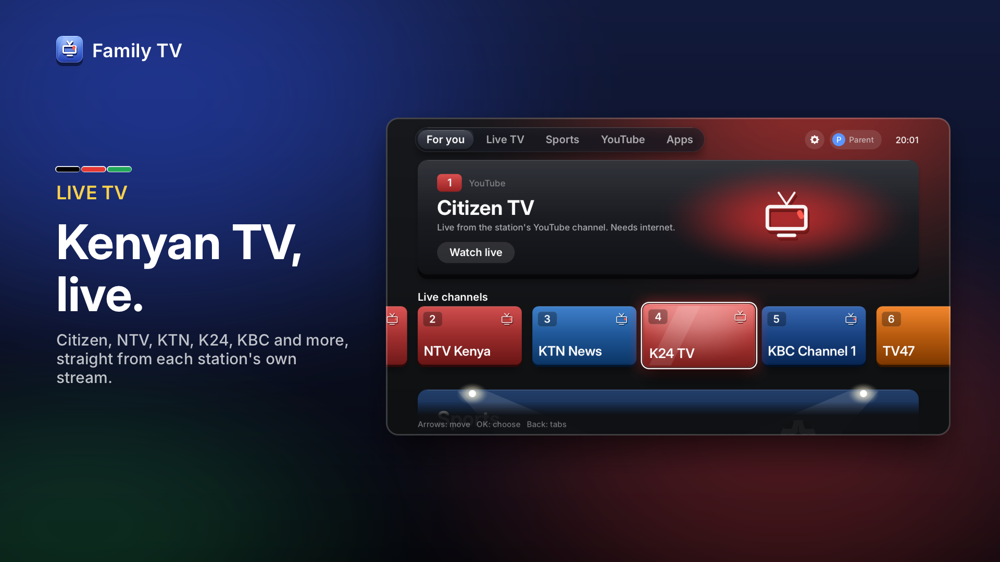
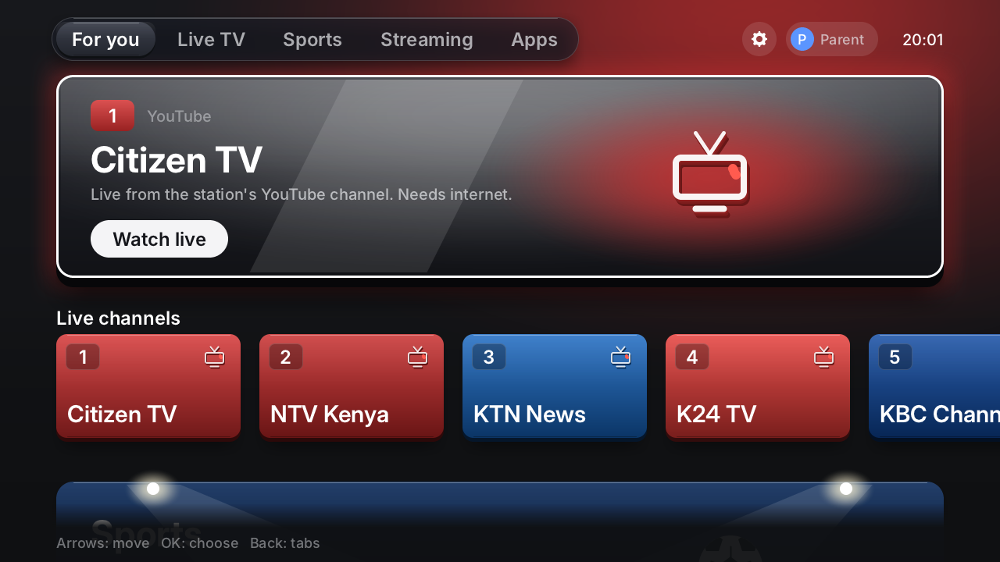

# Family TV

A TV-style home for a laptop: Kenyan TV channels from their YouTube live streams, a Sports tab with
live matches, YouTube inside the app, three family games, and parent controls (PIN, children's play
time). The look follows TCL's Google TV launcher (tabs along the top, a wide banner, rows of cards, a
channel guide, an info banner and channel list while watching) with 3D cards that turn toward the
mouse. Works with a remote-style keyboard or a mouse. Runs on Windows 10/11 and on Macs with Apple
silicon.

[](https://github.com/NaomiKwamboka0/family-tv/releases/latest/download/familytv-promo.mp4)

**[Watch the 30-second tour](https://github.com/NaomiKwamboka0/family-tv/releases/latest/download/familytv-promo.mp4)**
(drawn by the app itself; the colour bars stand in for the stations' live pictures)

## Download

From the [latest release](https://github.com/NaomiKwamboka0/family-tv/releases/latest):

| Your computer | Download |
|---|---|
| Windows 10 or 11 | [FamilyTV-Setup-1.0.0.exe](https://github.com/NaomiKwamboka0/family-tv/releases/latest/download/FamilyTV-Setup-1.0.0.exe) (installer) |
| Mac with Apple silicon (M1 or newer), macOS 15 or newer | [FamilyTV-1.0.0-macos.dmg](https://github.com/NaomiKwamboka0/family-tv/releases/latest/download/FamilyTV-1.0.0-macos.dmg) |

Family TV is not signed by a company yet, so the first start asks once. **Windows:** "Windows
protected your PC" → More info → Run anyway. **Mac:** "cannot check it for malicious software" →
Done, then System Settings → Privacy & Security → Open Anyway.



More screens: [docs/screens](docs/screens/README.md). What is tested and what is not:
[docs/STATUS.md](docs/STATUS.md).

## Using it

| Key | Home | Watching a channel |
|---|---|---|
| Arrows | move | Up/Down: channel, Left/Right: volume |
| Enter | choose | channel list (on an error: try again) |
| Backspace / Esc | up to the tabs | close the list, else back home (the stream stops) |
| F11 or F | full screen | full screen |
| Q | quit | quit |
| Mouse | point to move, click to choose, right-click = Back, wheel = up/down | move: info banner, click: channel list (click a channel to play it), wheel: volume |

- **Tabs:** For you, Live TV, Sports, YouTube, Apps.
- **Sports:** official sports channels that are live now or coming up, and *Live football now*: live
  football matches and watch-alongs found with YouTube's own live search. That search is filtered
  (no American football, school games, video-game "simulations" or talk shows) but not vetted, so it
  shows on the parent profile only.
- **YouTube** plays inside Family TV: a search bar (on-screen keyboard, or type on the laptop) and
  rows of football, Kenyan news, music and comedy. Parent profile only.
- **Netflix** cannot play inside any app but the browsers (its videos are copy-protected), so it opens
  full screen in a window of its own, without tabs: through Edge on Windows, Chrome/Edge/Brave on a
  Mac (else the normal browser). It uses the browser's Netflix sign-in.

- **Channels need internet.** Each one plays the station's YouTube live stream, through
  [yt-dlp](https://github.com/yt-dlp/yt-dlp) (with [Deno](https://deno.com)) and
  [libmpv](https://mpv.io). A channel takes about 10-15 s to start. Some stations stream only at
  certain times; Family TV then says the channel is not live right now.
- **Picture and data use** are set in Parent settings, "Live TV picture": 1080p (the default, 60
  frames a second where the channel offers it) about 2.6-3 GB an hour, 720p about 1.4 GB, 480p about
  0.6 GB, 360p about 0.5 GB. Nothing streams while the home screen is showing.
- **Channel list:** `channels.txt` (next to the program, or in the data folder to override it), one
  channel per line: `number|name|https://www.youtube.com/channel/<ID>/live|#colour`. Use the channel
  ID address, not the `@name` one: look-alike names belong to other channels.
  `tools/verify-channels.sh` checks addresses and prints channel IDs.
- **Parent settings** (gear, top right): language (English/Kiswahili), children's daily play time,
  which games children may play, live TV picture quality, parent PIN.
- **Data folder** (settings, saves, `familytv.log`): `%APPDATA%\FamilyTV\FamilyTV` on Windows,
  `~/Library/Application Support/FamilyTV/FamilyTV` on a Mac.

## Building

On the Mac (development):

```sh
brew install sdl2 mpv pkgconf   # mpv brings libmpv, yt-dlp and deno
make            # tests (sanitizers), font check, scripted walks, headless window check
make run        # Family TV in a window
make screens    # draw every screen to docs/screens/*.png
make promo      # the 30-second advert: out/promo/familytv-promo.mp4 (needs ffmpeg)
make bench      # milliseconds per frame per screen
```

Windows zip and installer, cross-built on the Mac:

```sh
brew install mingw-w64 sevenzip makensis
make win-deps   # SDL2, libmpv, yt-dlp, deno: pinned versions, SHA-256 checked (tools/win-deps.lock)
make win-zip    # out/win/FamilyTV-<version>-windows.zip: unzip on the laptop, run FamilyTV.exe
make win-setup  # out/win/FamilyTV-Setup-<version>.exe: installer with shortcuts and an uninstaller
make win-test   # out/win/test-core.exe: the unit tests as a Windows program
```

Mac app (Apple silicon), with Homebrew's libraries copied inside:

```sh
brew install dylibbundler
make mac-deps   # yt-dlp and deno for macOS: pinned, SHA-256 checked (tools/mac-deps.lock)
make mac-dmg    # out/mac/FamilyTV-<version>-macos.dmg; mac-check proves nothing comes from Homebrew
```

`make release` builds all three into `out/release` with `SHA256SUMS.txt`. Pushing a tag such as
`v1.0.0` (matching `VERSION` in the Makefile) makes GitHub build them, install and start each on a
clean Windows and Mac machine, and publish the release with the video
([.github/workflows/release.yml](.github/workflows/release.yml)).

Native Windows build ([MSYS2](https://www.msys2.org), UCRT64 shell), for checking on the laptop
itself:

```sh
pacman -S make python mingw-w64-ucrt-x86_64-{gcc,pkgconf,SDL2,mpv}
make test window   # unit tests (no sanitizers on Windows) and out/host/familytv.exe
```

Handy switches: `--player stub` (test card instead of streams), `--stats` (frame cost overlay while
watching), `--verbose` (player messages on the terminal), `--data DIR`, `--fullscreen`,
`--keys OK,W60,...` (scripted keys; add `--player mpv` to try real streams headlessly with
`SDL_VIDEODRIVER=dummy`). `FAMILYTV_MPV="hwdec=no;..."` passes extra mpv options.

## Layout

| Folder | What |
|---|---|
| `ui/` | software canvas, fonts, artwork, the home state machine (`shell`), live TV (`live`), views |
| `media/` | player interface, libmpv player, stub player, error classifier |
| `services/` | settings (with PIN), play time, channels, viewer prefs, translations, session |
| `games/` | Family Racer, Penalty Cup, Block Garden, checksummed saves |
| `sim/` | the program: main loop, SDL window, terminal frontend, screenshot, bench and advert tools |
| `platform/` | randomness, clocks and files on macOS and Windows |
| `packaging/` | Windows manifest, icon and installer; macOS Info.plist and icon; READMEs, licence notices, release notes |
| `tools/` | font and icon bakers, channel checker, dependency fetcher |

The LG TV version (hardware evidence, probes, gate checks) is at git tag `lg-tv-final`.
