# Screens

These pictures come from `make screens`, which draws each screen with the app's own software renderer
at 1280x720. The layout follows TCL's Google TV launcher (tabs along the top, a wide banner, rows of
cards, a channel guide, an info banner and a channel list while watching), drawn with our own artwork
and the open Inter typeface. Live TV shots show the stub player's colour bars where the station's
picture would be.

| | |
|---|---|
|  For you: last channel, channel row, games | 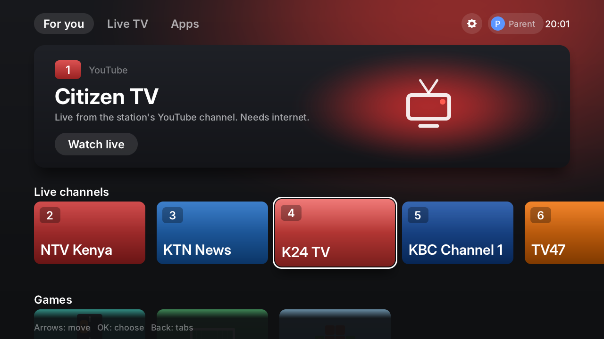 Moving along the channel row |
| 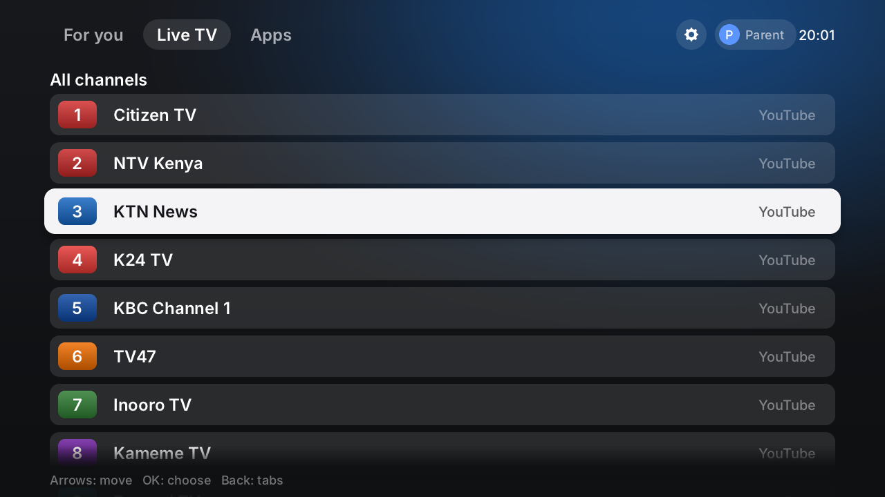 Live TV tab: the channel guide | 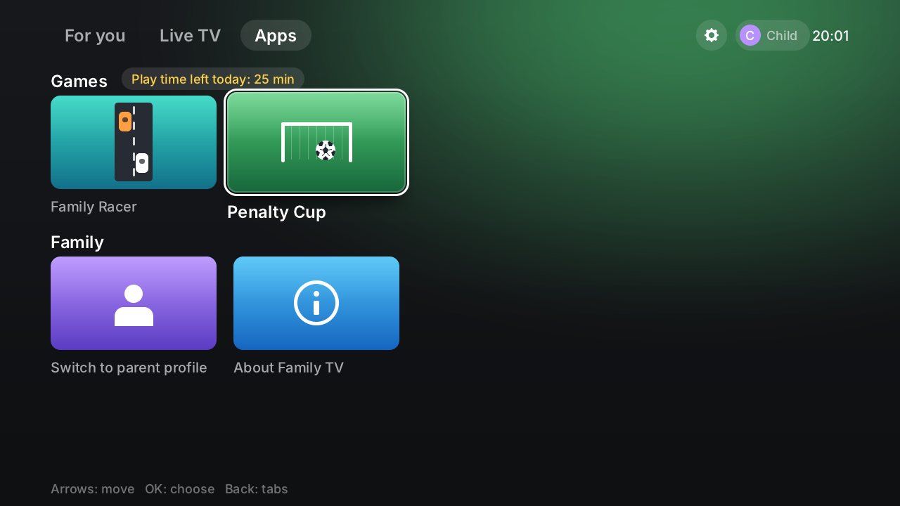 Apps tab, child profile with play time left |
| 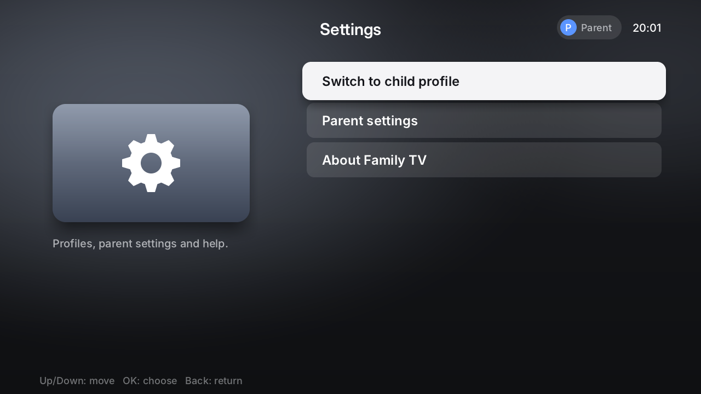 Settings (gear) | 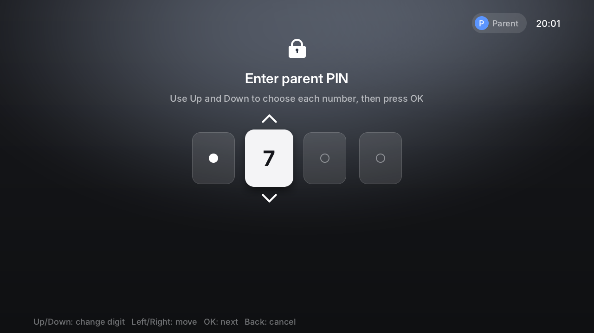 Parent PIN (only the digit being changed is shown) |
| 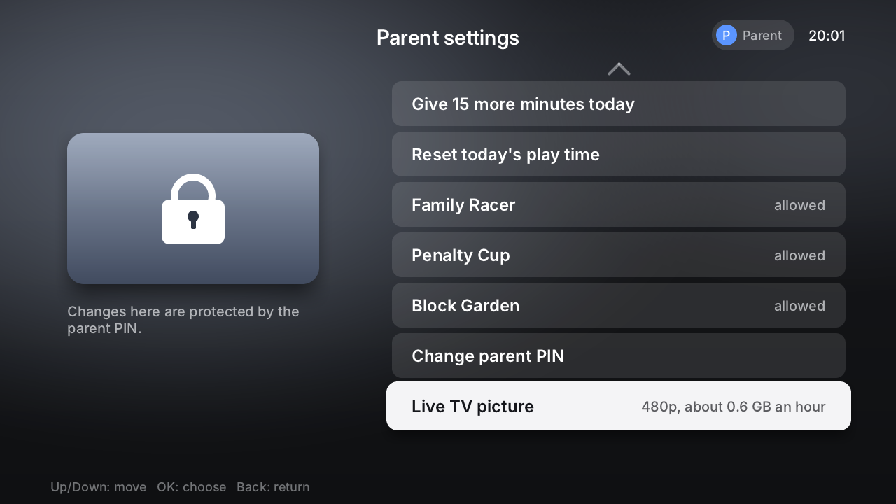 Parent settings: live TV picture and data use | 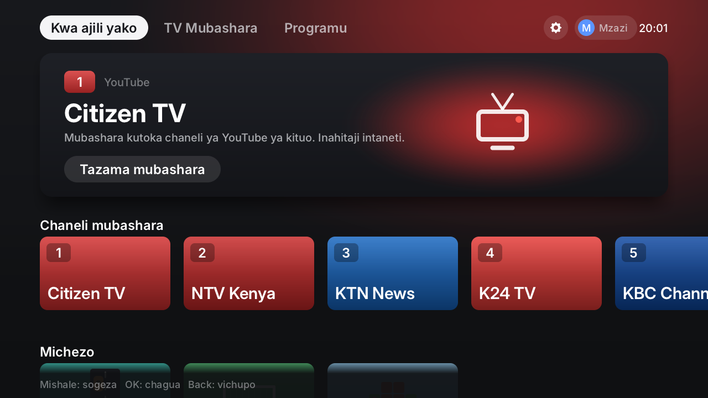 Home in Kiswahili |
| 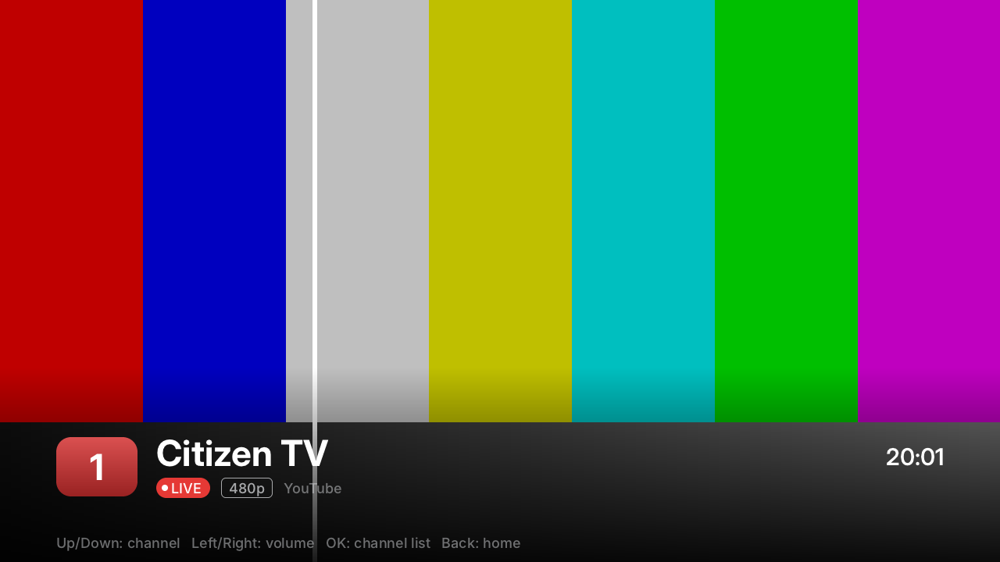 Watching: info banner | 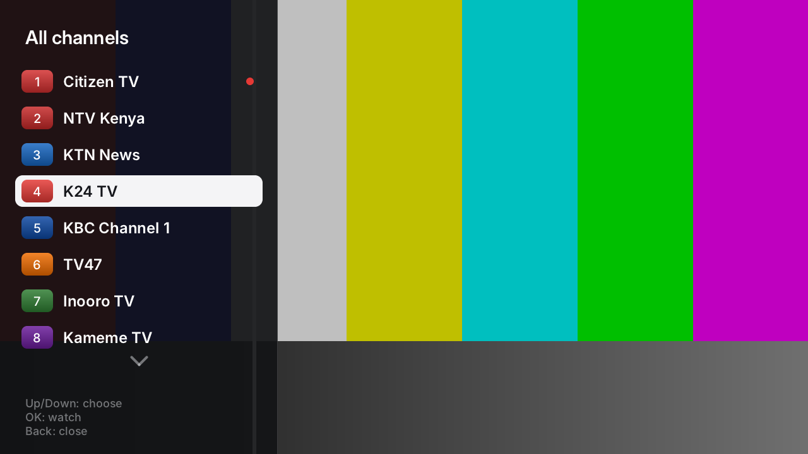 Watching: channel list (OK) |
| 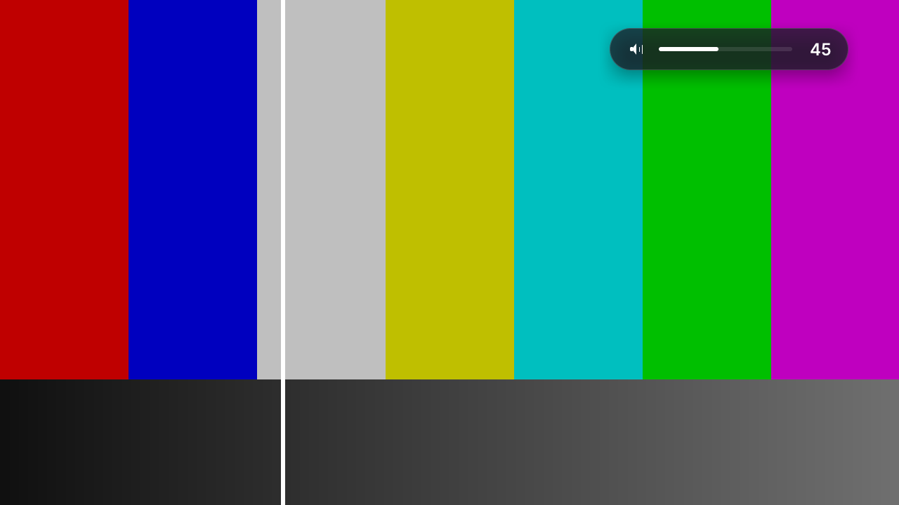 Watching: volume (Left/Right) | 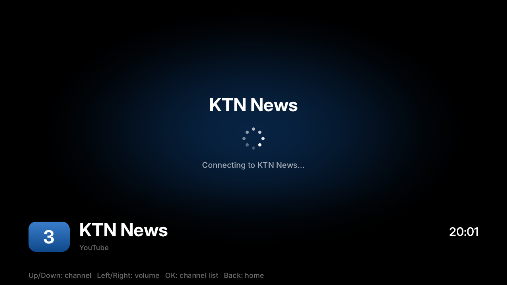 Connecting to a channel |
| 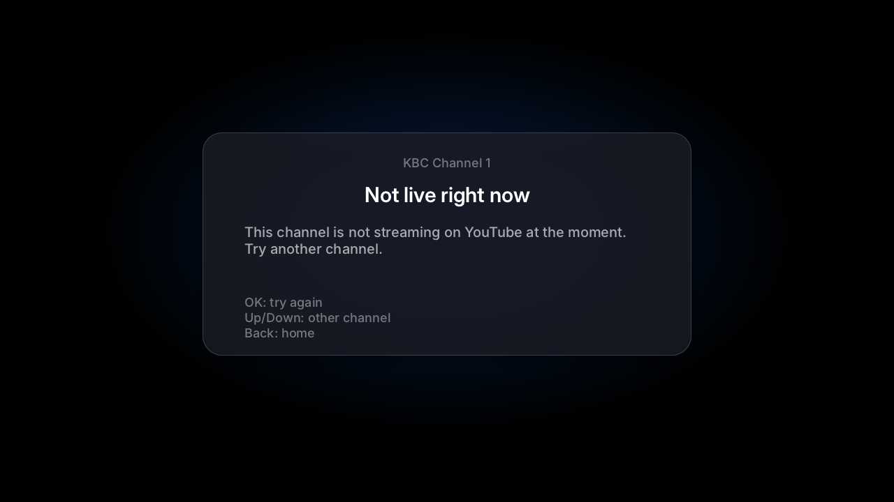 The channel is not live right now | 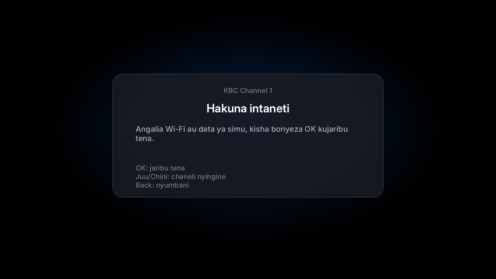 No internet, in Kiswahili |
|  Family Racer, start | 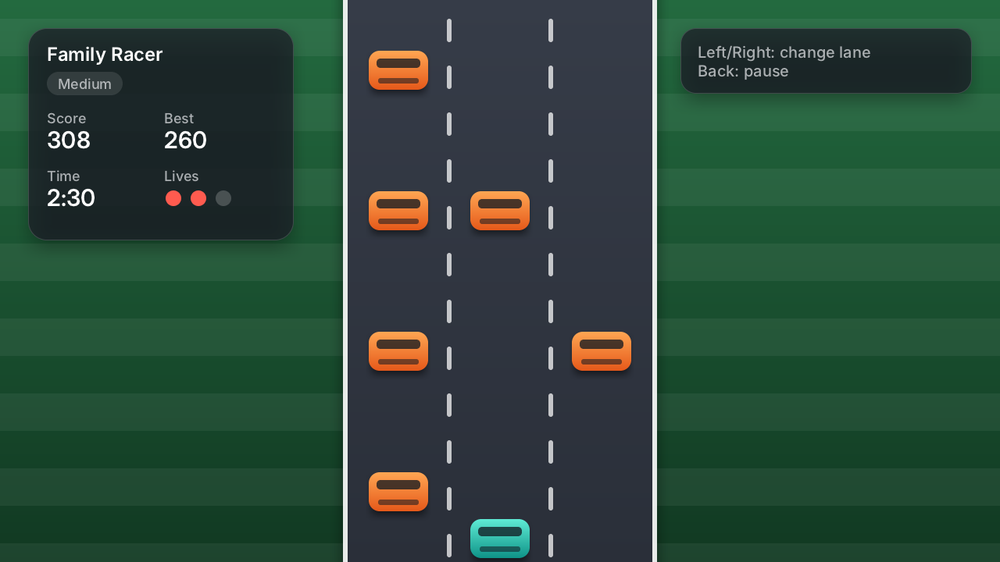 Family Racer |
| 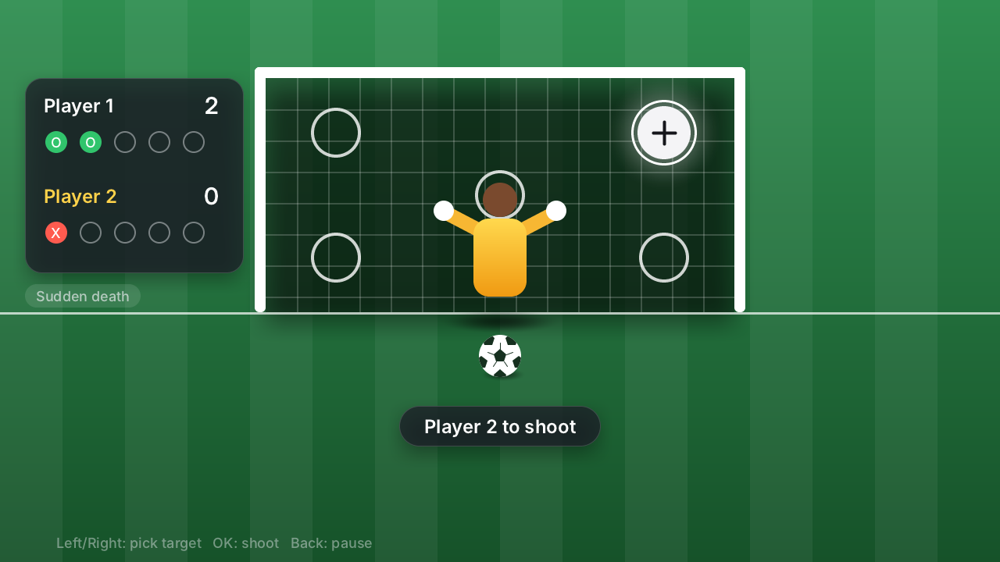 Penalty Cup, aiming | 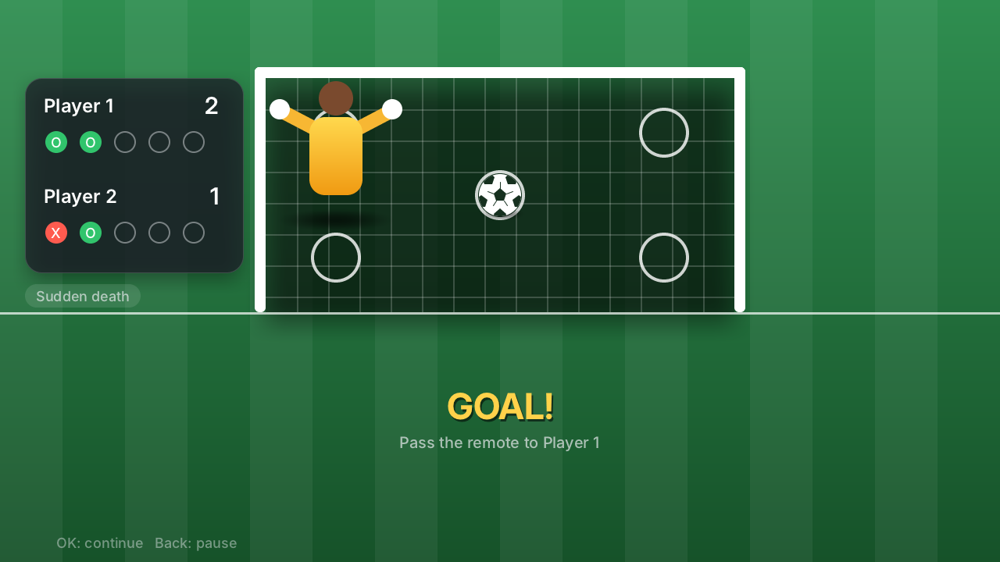 Penalty Cup, goal |
| 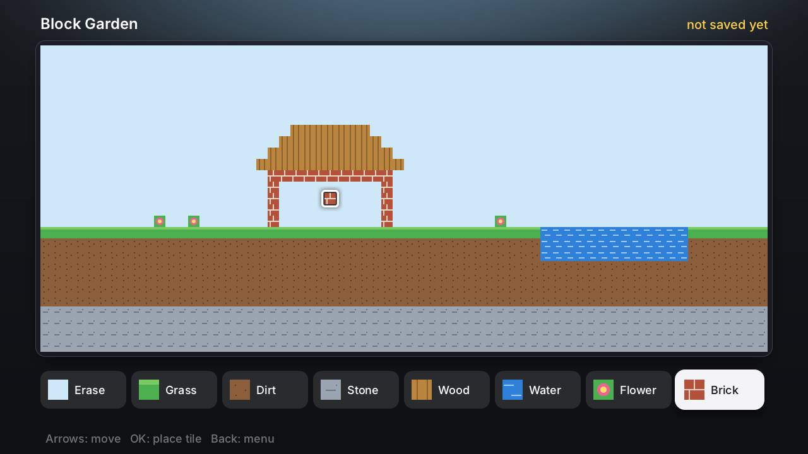 Block Garden | 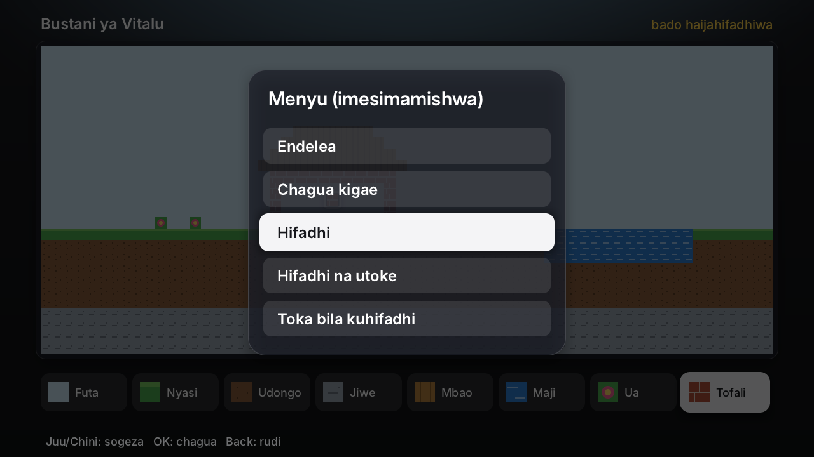 Block Garden menu, Kiswahili |
