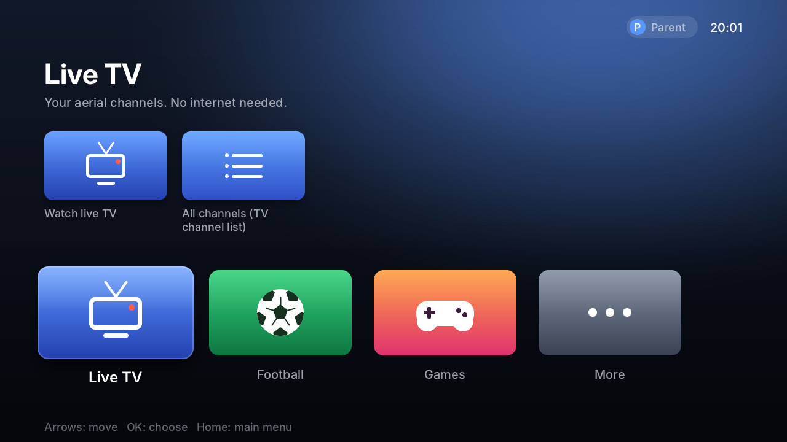
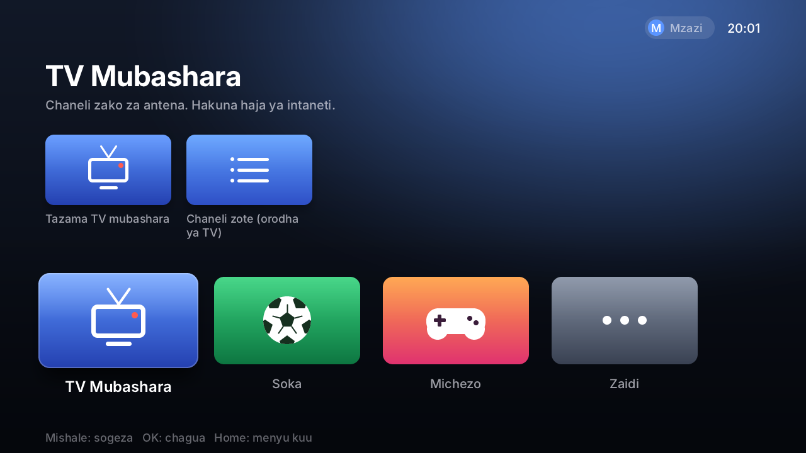
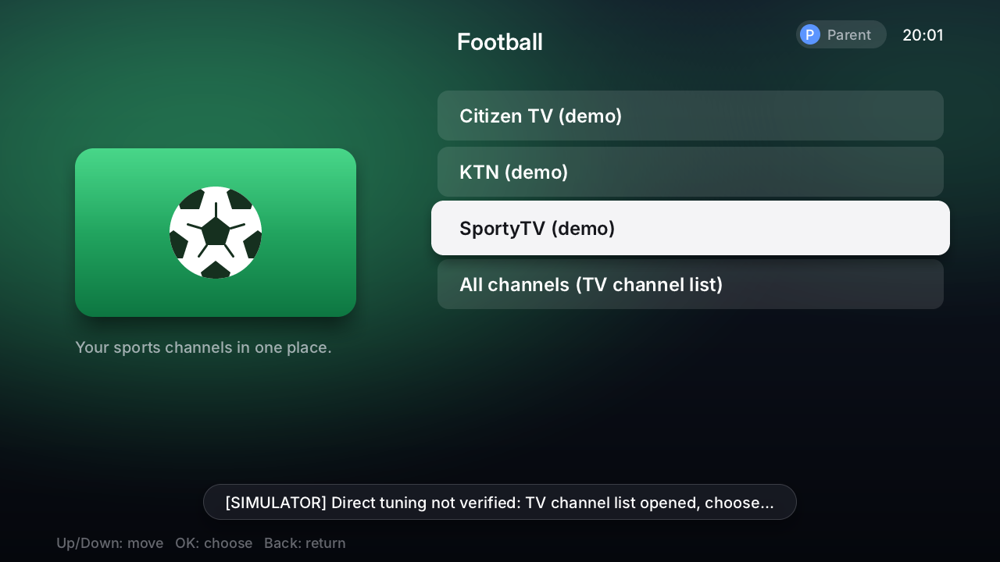
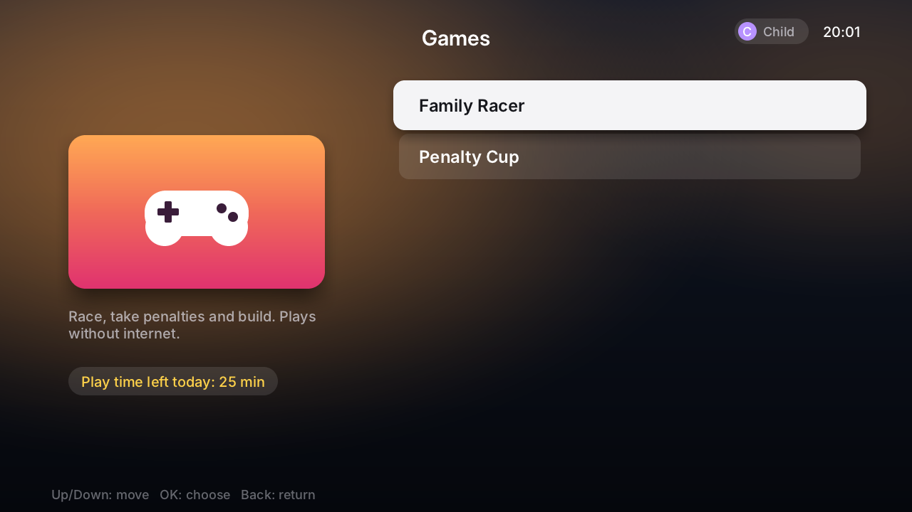
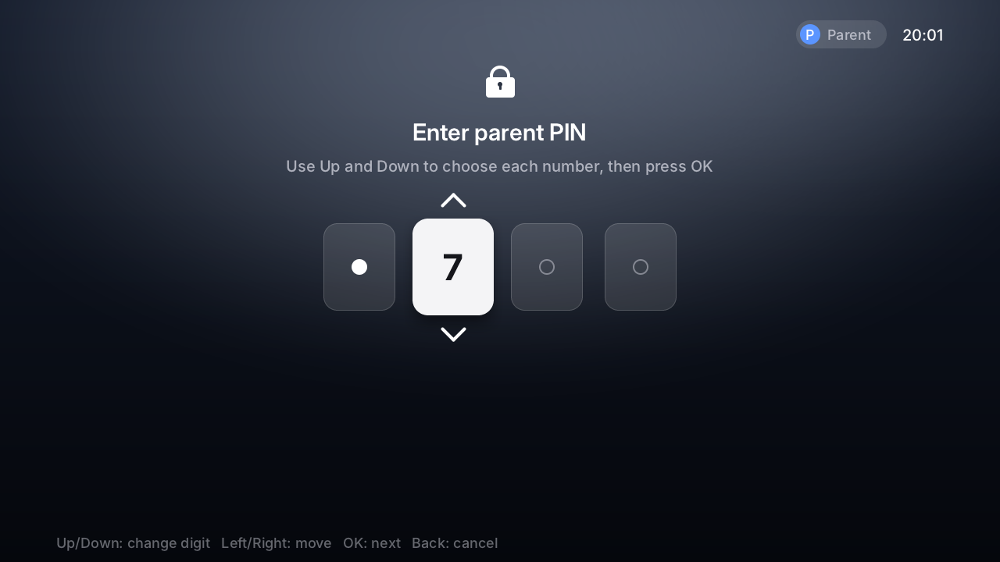
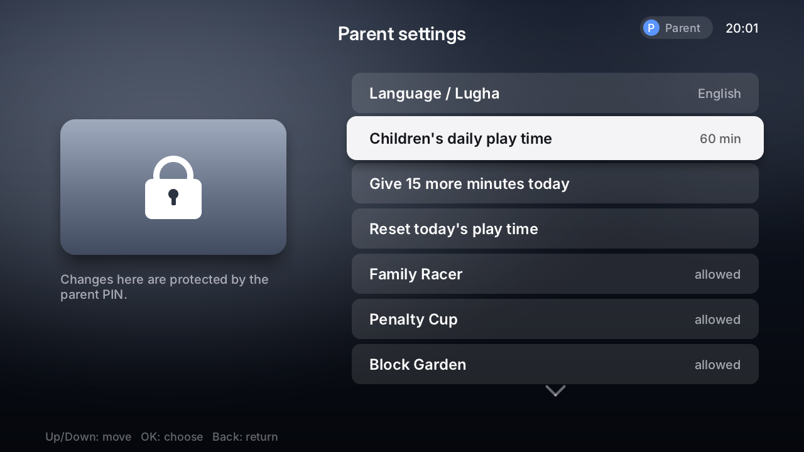
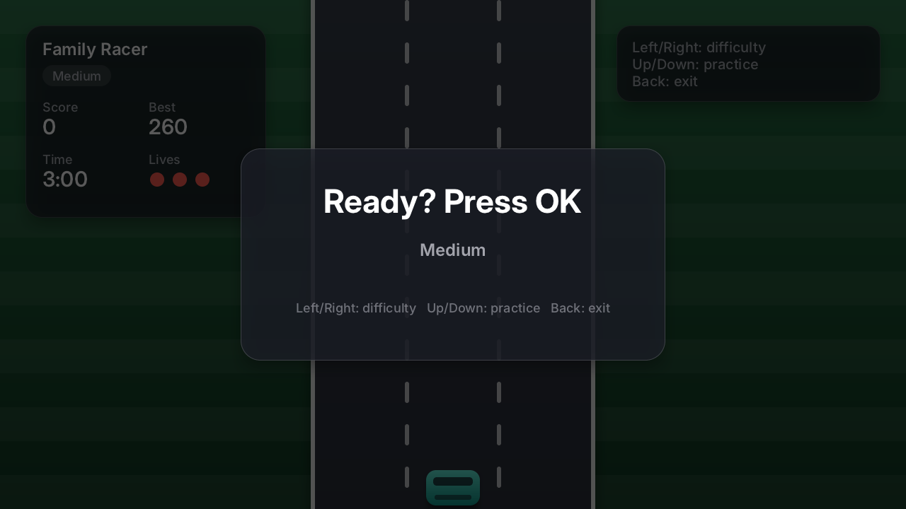
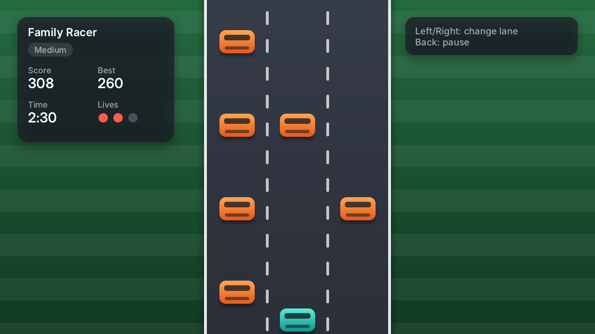
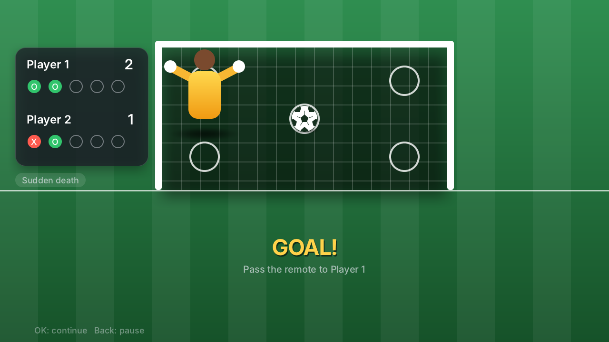
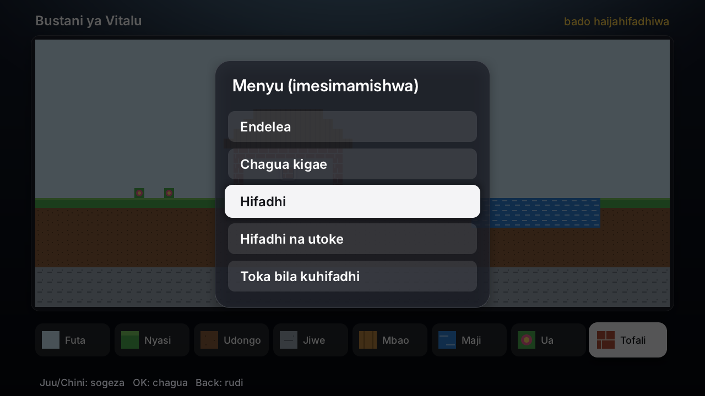

# Screens (rendered on the computer)

These pictures come from `make screens`, which draws each screen with the same software renderer
intended for the TV (1280x720). The look is inspired by Apple TV (top shelf that follows focus, tiles that
lift when focused, white focused rows, glass panels) using our own artwork and the open Inter typeface.
They show layout and wording only. Real colours, sharpness and speed
on the LG panel are not known until gate I05 (display) passes. The football favourites are demo data.

| | |
|---|---|
|  Home |  Home, Kiswahili |
|  Football favourites |  Games, child profile |
|  Parent PIN (only the digit being changed is shown) |  Parent settings |
|  Family Racer, start |  Family Racer |
|  Penalty Cup, aiming |  Penalty Cup, goal |
|  Block Garden |  Block Garden menu, Kiswahili |
